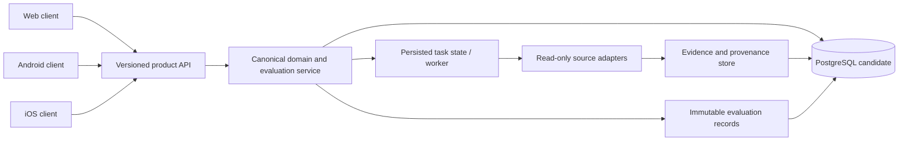

# Evaluación del stack tecnológico (Issue #9)

**Estado:** evaluación documental inicial; decisión final condicionada a PoC ejecutables.  
**Fecha de corte:** 2026-10-24.  
**Alcance:** clientes web, Android/iOS, API central, almacenamiento histórico, procesamiento asíncrono, calidad/seguridad y operación.  
**No constituye** una certificación ISO, una prueba de rendimiento ni una validación de producción.

## 1. Requisitos que condicionan la selección

1. Clientes web, Android e iOS comparten contratos y resultados canónicos; escritorio solo si un requisito posterior lo justifica.
2. El cliente no contiene claves de proveedores ni reglas analíticas canónicas.
3. API versionada y documentada con OpenAPI; validación de contratos automatizada.
4. Persistencia de observaciones y evaluaciones históricas con procedencia, timestamps, versión metodológica y reproducibilidad.
5. Captura externa pública en modo read-only; ninguna orden real de trading.
6. Ejecución bajo demanda, abstención explícita ante datos insuficientes y manejo visible de errores/obsolescencia.
7. El diseño inicial debe poder ejecutarse y probarse localmente en Windows con recursos limitados; no introducir infraestructura distribuida sin evidencia de necesidad.

## 2. Matriz de decisión: criterios y pesos de trabajo

Los pesos son una propuesta de evaluación que suma 100%; deben aprobarse antes de puntuar. Las puntuaciones permanecen **N/E (no evaluadas)** hasta ejecutar PoC comparables. No se asigna un ganador ficticio.

| Dominio | Peso | Evidencia/medición requerida |
|---|---:|---|
| Adecuación funcional y contratos compartidos | 20% | Casos de uso, contrato OpenAPI, validación cliente-servidor |
| Mantenibilidad y reutilización multiplataforma | 15% | Duplicación real, estructura, experiencia de desarrollo |
| Gráficos y manejo de series de mercado | 15% | OHLCV, zoom/pan, volumen y carga de datos reproducible |
| Seguridad y privacidad | 15% | Dependencias, permisos, secretos, logs, límites de confianza |
| Persistencia histórica y consultas | 10% | Escritura/lectura, integridad temporal, consulta por activo/horizonte |
| Pruebas y CI reproducibles | 10% | Tests repetibles desde entorno limpio y artefactos de resultados |
| Recursos locales y experiencia de build | 5% | Versiones, tiempo de build, memoria y tamaño de artefacto |
| Coste operativo/licencias/soporte | 5% | Licencias, mantenimiento, soporte y servicios requeridos |
| Incertidumbre y reversibilidad | 5% | Riesgo de bloqueo, migración y condición de reconsideración |

### Regla de puntuación

- Escala propuesta: 1 (insuficiente), 2 (débil), 3 (aceptable), 4 (fuerte), 5 (muy fuerte).
- Cada puntuación debe enlazar a evidencia reproducible y anotar incertidumbre.
- Resultado ponderado = suma de (peso × puntuación / 5); no calcularlo mientras existan dominios críticos N/E.
- Sensibilidad: recalcular al variar cada peso ±20% y documentar si cambia la alternativa ganadora.
- Umbral de aceptación y reglas para N/E deben aprobarse antes de examinar resultados; no inventar umbrales tras ver la salida.

## 3. Alternativas a probar

| Capa | Candidatos | Riesgo que decide la PoC |
|---|---|---|
| Web | TypeScript + React/Next.js; alternativa React/Vite si SSR no es requisito | Complejidad de despliegue frente a necesidad real de SSR |
| Móvil | Flutter; React Native; Android nativo Kotlin como referencia | Gráficos, accesibilidad, integración, pruebas y coste de mantener iOS |
| API | Python + FastAPI; alternativa Python + Django REST Framework | Contratos, validación, latencia y complejidad de servicio |
| Datos | PostgreSQL sin extensión especializada inicialmente | Consultas históricas, índices, particionado y retención con volumen representativo |
| Tareas asíncronas | Proceso/worker simple y persistente antes de añadir broker | Reintentos, idempotencia, recuperación y observabilidad |
| Streaming/caché/objetos | Diferir hasta demostrar requisito | Carga, latencia, tamaño, coste y necesidad de retención binaria |
| Contratos | OpenAPI + validación y generación de tipos/clientes cuando aporte valor | Detección de incompatibilidades y deriva entre clientes |
| Calidad | pytest u otras herramientas adecuadas a cada lenguaje; análisis estático y escaneo de dependencias | Repetibilidad, cobertura de comportamiento crítico y falsos positivos |

## 4. Plan de PoC reproducibles (obligatorio antes de decisión final)

Todas las alternativas comparadas deben usar el mismo caso de uso, dataset de prueba versionado y criterios fijados previamente.

### PoC-A: contrato API
- Definir un contrato mínimo versionado para buscar un activo y obtener una evaluación fechada.
- Incluir estados de datos insuficientes, timeout, error del proveedor y resultado obsoleto.
- Validar ejemplos válidos e inválidos, compatibilidad y errores de esquema.
- Registrar comandos, versiones, salida y hashes de artefactos.

### PoC-B: persistencia histórica
- Guardar dos evaluaciones de un mismo activo sin sobrescribir la anterior.
- Consultar por activo, horizonte y fecha; verificar orden temporal, procedencia y versión metodológica.
- Registrar plan de consulta y tiempos solo con dataset y entorno descritos; no extrapolar resultados.

### PoC-C: cliente multiplataforma y gráficos
- Implementar la misma pantalla de búsqueda/ficha en las alternativas móviles consideradas.
- Renderizar el mismo fixture OHLCV, con volumen, zoom/desplazamiento y estados vacíos/error.
- Probar escalado de texto, lector de pantalla, movimiento reducido y orientación/tamaño de pantalla.
- En React Native/Flutter, registrar versiones y comandos de build en Windows; Android nativo sirve como referencia, no como decisión automática.

### PoC-D: tarea asíncrona
- Ejecutar una tarea de investigación con clave de idempotencia, reintento acotado y estados persistidos.
- Demostrar que un fallo de red no se convierte en captura válida ni duplica efectos.
- Verificar recuperación tras terminar el proceso y visibilidad del fallo.

### PoC-E: CI y seguridad
- Ejecutar pruebas desde un entorno limpio, análisis estático y revisión de dependencias.
- No imprimir secretos ni datos sensibles en logs.
- Conservar artefactos de resultados y versión exacta de herramientas.
- Un workflow verde solo acredita los checks ejecutados; no acredita rendimiento, conformidad ISO ni preparación para producción.

## 5. Diseño de límites recomendado para validar

- **Clientes:** presentación, accesibilidad, estado local no canónico y visualización; sin claves de proveedores ni lógica analítica duplicada.
- **API de producto:** autenticación/autorización, validación de contratos, versionado, límites de solicitud y respuestas de error consistentes.
- **Servicios de dominio:** identidad de activos/mercados, evaluación, metodología versionada, ranking y evidencia temporal.
- **Adaptadores de fuentes:** conectores aislados con permisos, límites, trazabilidad, procedencia y manejo de fallos específicos.
- **Persistencia:** PostgreSQL candidato inicial para metadatos, evaluaciones y observaciones normalizadas; validar el patrón temporal antes de extensiones especializadas.
- **Worker:** inicialmente proceso sencillo con estado persistido e idempotencia; introducir broker/caché/streaming solo con evidencia de carga o latencia.
- **CI y observabilidad:** pruebas, auditoría de cambios, logs estructurados sin secretos, métricas de fallos y artefactos reproducibles.

## 6. Registro de evidencia actual y brechas

- README de main describe clientes web, Android e iOS conectados a una plataforma central y prohíbe inferir preparación para producción sin evidencia integral.
- El comentario previo en Issue #9 registró que no se encontraron en la raíz los marcadores habituales de una aplicación Android/Flutter/React Native; tampoco acreditó una compilación móvil.
- El comentario de auditoría asociado a Issue #270 calificó provisionalmente la selección tecnológica en 3/10 por ausencia de PoC comparativas y benchmarks verificables.
- La rama de trabajo debe completar PoC, actualizar esta matriz con evidencias reales y registrar el ADR final. Hasta entonces, el stack definitivo queda **pendiente**, no aprobado.

## 7. Condiciones de cierre del Issue #9

- [ ] Matriz con puntuaciones respaldadas por evidencia y análisis de sensibilidad.
- [ ] PoC ejecutables para API, cliente/gráficos, persistencia y tareas asíncronas.
- [ ] Comandos, versiones, entorno, resultados y fallos reproducibles.
- [ ] ADR final con alternativa seleccionada, consecuencias, riesgos y condiciones de revisión.
- [ ] CI relevante verde y PR revisado; ningún cambio directo a main.
- [ ] Los resultados no afirman conformidad ISO/certificación ni rendimiento no medido.

**Conclusión actual:** la arquitectura lógica y el protocolo de evaluación quedan definidos, pero cerrar el Issue como completado antes de las PoC sería una afirmación no respaldada.


## 8. CI observada para el PR #301 (2026-10-24)

Se consultaron las ejecuciones asociadas al commit `569e9712d6e5fa5c94dc6a0b4545f3bd3f5935fd`. Dos workflows finalizaron con los jobs observados en PASS:

| Workflow | Run ID | Job | Resultado observado | Alcance real |
|---|---:|---|---|---|
| Reproducible market capture evaluation | 40056223784 | Test offline capture evaluation | PASS | Pruebas unitarias existentes, fixture sintético determinista y comparación de salidas; no compara stacks de aplicación |
| Requirements traceability validation | 40056223782 | Validate requirements catalogue and traceability | PASS | Validador del catálogo de requisitos y trazabilidad; no demuestra que las PoC de este Issue estén ejecutadas |

En ambas ejecuciones, el job de detección de alcance también terminó correctamente. Esto significa que los workflows existentes se ejecutaron, pero **no** constituye PASS de PoC de FastAPI/alternativas, clientes móviles, gráficos, PostgreSQL o procesamiento asíncrono. Tampoco demuestra que todos los checks del PR estén terminados ni que el stack esté aprobado.

- Run 40056223784: https://github.com/Osleyder1985/crypto-intelligence-ecosystem/actions/runs/40056223784
- Run 40056223782: https://github.com/Osleyder1985/crypto-intelligence-ecosystem/actions/runs/40056223782
- PR: https://github.com/Osleyder1985/crypto-intelligence-ecosystem/pull/301


## 9. Artefacto adicional: contrato API preliminar

Se añadió `docs/architecture/stack-poc-openapi.yaml` con un contrato OpenAPI 3.1.0 provisional para:
- búsqueda del catálogo canónico de activos;
- consulta de evaluaciones históricas inmutables por activo/horizonte;
- solicitud de evaluación bajo demanda con clave de idempotencia;
- consulta del estado de procesamiento y estados explícitos `failed`/`indeterminate`.

El servidor `example.invalid` es deliberadamente un marcador de posición, no un endpoint operativo. El contrato todavía requiere validación con un parser OpenAPI, pruebas de contrato y revisión de autenticación/autorización antes de considerarse válido o implementado. La existencia del YAML no acredita una API funcionando.

## 10. Diagrama de límites propuesto



Este diagrama expresa límites propuestos, no infraestructura desplegada. La elección concreta de worker, persistencia de evidencia y almacenamiento de objetos queda pendiente de PoC y requisitos de retención.

## 11. Estado actualizado de aceptación

- [x] Criterios y pesos de evaluación documentados como propuesta (sin puntuaciones inventadas).
- [x] ADR provisional con alternativas, riesgos y condiciones de revisión.
- [x] Contrato OpenAPI inicial y diagrama lógico propuestos.
- [x] Dos workflows existentes observados en PASS, con sus límites documentados.
- [x] Validación automática de sintaxis/estructura OpenAPI 3.1.0 con `openapi-spec-validator` (run 40056998001 PASS).
- [x] PoC API FastAPI/SQLite: búsqueda, Bearer auth configurable, idempotencia, errores y consulta de historial (run 40056917356 PASS).
- [x] PoC PostgreSQL 16: orden histórico y bloqueo de UPDATE/DELETE (run 40056885420 PASS).
- [x] Worker secuencial PoC: procesa una solicitud persistida y devuelve `indeterminate` cuando no hay motor analítico (test incluido en run 40056998071 PASS).
- [ ] Pruebas de contrato cliente-servidor; el validador OpenAPI por sí solo no las sustituye.
- [ ] Worker con concurrencia, reintentos y recuperación demostrada tras interrupción.
- [ ] PoC comparativas de cliente móvil/gráficos (Flutter, React Native y referencia nativa) y web.
- [ ] Medición representativa de persistencia/consultas, seguridad/licencias y recursos de build.
- [ ] Matriz puntuada con resultados medidos y análisis de sensibilidad.
- [ ] ADR definitivo ratificado y revisión del PR.


## 12. CI específico del contrato OpenAPI

Se añadió `.github/workflows/issue-9-openapi-contract.yml`. En el commit `b64ce55e49c4271ad7702697e43a08c0b599c5c8` se sustituyó la validación artesanal por el validador de especificaciones OpenAPI `openapi-spec-validator==0.7.2`, con Python 3.12 y las acciones de checkout/setup-python fijadas a SHA completos.

Comando configurado en CI:

```bash
python -m pip install --disable-pip-version-check openapi-spec-validator==0.7.2
openapi-spec-validator docs/architecture/stack-poc-openapi.yaml
```

**Estado de ejecución:** no confirmado. La consulta de ejecuciones asociadas a ese commit y los estados combinados no devolvió resultados; por tanto, no se registra PASS hasta que GitHub Actions publique un resultado verificable. Incluso con el validador OpenAPI en PASS, seguirán pendientes las pruebas de contrato cliente-servidor y las PoC comparativas de API, persistencia histórica, cliente/gráficos y tareas asíncronas.

## 13. PoC ejecutable de API, historial e idempotencia

Se añadieron `scripts/stack_poc/research_api.py`, `tests/stack_poc/test_research_api.py` y el workflow `.github/workflows/issue-9-stack-poc.yml`. La PoC usa FastAPI con SQLite para poder ejecutar pruebas sin un servicio de base de datos local; **SQLite es únicamente una ayuda de prueba y no valida PostgreSQL ni sustituye la PoC de persistencia requerida**.

Comportamientos que cubren las pruebas automatizadas:
- búsqueda del catálogo de activos y forma de respuesta vacía;
- autenticación Bearer configurable, sin credencial predeterminada; el servicio falla cerrado si no se configura el secreto;
- solicitud bajo demanda con clave de idempotencia, repetición del mismo payload y conflicto HTTP 409 cuando la clave se reutiliza con otro payload;
- errores 404 para activo/solicitud inexistente;
- persistencia de dos evaluaciones históricas con metodología distinta, orden temporal y filtro por horizonte.

El workflow instala versiones fijadas de FastAPI y HTTPX y ejecuta `unittest` en Python 3.12. **Resultado CI observado:** el run [40056765545](https://github.com/Osleyder1985/crypto-intelligence-ecosystem/actions/runs/40056765545) ejecutó el job `api-history-idempotency` con conclusión `success` y los tests terminaron en `success`. En un run posterior, [40056876572](https://github.com/Osleyder1985/crypto-intelligence-ecosystem/actions/runs/40056876572), la suite falló porque el workflow SQLite descubrió también `test_postgres_history.py` sin instalar `psycopg`. Se corrigió el workflow para ejecutar solo `test_research_api.py`. La ejecución corregida [40056917356](https://github.com/Osleyder1985/crypto-intelligence-ecosystem/actions/runs/40056917356) terminó con el job `api-history-idempotency` en `success`, incluidos los tests. El fallo anterior se conserva como evidencia de la corrección y no se oculta. La implementación no ejecuta análisis real ni worker asíncrono: las solicitudes permanecen `queued` en esta PoC. Tampoco implementa autorización por roles, migraciones, PostgreSQL, límites operativos ni pruebas de concurrencia; estos son riesgos/alcances pendientes.

## 14. PoC de persistencia PostgreSQL

Se añadió `scripts/stack_poc/postgres_schema.sql`, una prueba de integración `tests/stack_poc/test_postgres_history.py` y el workflow `.github/workflows/issue-9-postgres-poc.yml`. El workflow levanta PostgreSQL 16 como servicio efímero, instala `psycopg[binary]==3.2.6` y ejecuta pruebas con Python 3.12.

La PoC verifica:
- escritura de evaluaciones distintas para el mismo activo, con horizonte y versión metodológica;
- orden de consulta por timestamp descendente;
- rechazo explícito de `UPDATE` y `DELETE` sobre el historial mediante trigger de PostgreSQL.

**Resultado CI observado:** los runs [40056876625](https://github.com/Osleyder1985/crypto-intelligence-ecosystem/actions/runs/40056876625) y [40056885420](https://github.com/Osleyder1985/crypto-intelligence-ecosystem/actions/runs/40056885420) completaron el job `postgres-history` con conclusión `success`, incluidos inicialización del servicio PostgreSQL, instalación de psycopg y ejecución de las pruebas. Es una prueba de esquema/retención de historial, no un benchmark representativo, una migración de producción ni una validación de recuperación/backup. El worker persistente y la idempotencia transaccional todavía requieren PoC separada.

## 15. Worker persistente de PoC y abstención explícita

Se añadió `scripts/stack_poc/research_worker.py` y una prueba que solicita dos horizontes, procesa una tarea pendiente una sola vez, verifica que una segunda ejecución no duplique el resultado y consulta el estado persistido. Cuando el motor analítico no está integrado, el worker registra resultados `indeterminate` con la limitación `analysis_engine_not_integrated`; no inventa una evaluación de inversión.

La respuesta de `GET /v1/evaluation-requests/{request_id}` y el contrato OpenAPI se ajustaron para devolver una lista de evaluaciones por horizonte. El workflow API run [40056998071](https://github.com/Osleyder1985/crypto-intelligence-ecosystem/actions/runs/40056998071) ejecutó el paso de tests con conclusión `success`; el job estaba terminando la limpieza cuando se verificó. El workflow OpenAPI run [40056998001](https://github.com/Osleyder1985/crypto-intelligence-ecosystem/actions/runs/40056998001) completó el paso de validación con `success`.

**Límite restante:** este worker PoC procesa una tarea en una transacción SQLite y demuestra persistencia/idempotencia secuencial. No acredita concurrencia entre múltiples workers, recuperación tras caída a mitad de ejecución, reintentos temporizados ni integración con fuentes/analizador real. Esos casos requieren pruebas específicas antes de considerar completa la PoC asíncrona.


## 16. Verificación adicional del worker: concurrencia y rollback transaccional

Se añadieron `tests/stack_poc/test_worker_reliability.py` y un paso dedicado en `.github/workflows/issue-9-stack-poc.yml`. El run [40057212197](https://github.com/Osleyder1985/crypto-intelligence-ecosystem/actions/runs/40057212197) completó con `success` los pasos `Run API, history and idempotency PoC tests` y `Run worker concurrency and transaction-recovery tests`. La validación OpenAPI del mismo HEAD también pasó en el run [40057212129](https://github.com/Osleyder1985/crypto-intelligence-ecosystem/actions/runs/40057212129).

Casos añadidos:
- ocho workers concurrentes compiten por doce solicitudes persistidas; cada solicitud se procesa una vez, quedan 24 evaluaciones para dos horizontes por solicitud y no aparecen duplicados por clave `(request_id, horizon)`;
- una transacción que cambia temporalmente una solicitud a `running` se revierte antes del commit; se comprueba que la solicitud sigue `queued`, un worker la procesa después y una segunda ejecución no crea resultados adicionales.

**Alcance preciso:** esto prueba concurrencia de procesos/hilos contra la misma base SQLite y recuperación tras rollback de transacción. No equivale a matar un proceso en medio de operaciones externas, recuperación distribuida, reintentos con backoff, leasing/visibilidad de cola ni garantía de entrega exactamente-una-vez entre sistemas. Como el worker no llama a proveedores ni al motor analítico, no prueba reintentos de red ni recuperación de una evaluación real. El run PostgreSQL del mismo commit debe verificarse por separado antes de registrar PASS actualizado.

## 17. Estado de cierre actualizado

- [x] PoC de concurrencia local con múltiples workers y solicitudes persistidas.
- [x] Prueba de rollback transaccional y reprocesamiento secuencial sin duplicar resultados.
- [x] CI del worker reliability: run 40057212197, ambos pasos de test en success.
- [x] Validación OpenAPI en el HEAD de esta ampliación: run 40057212129, success.
- [ ] Recuperación ante terminación forzada del proceso y fallos entre sistemas externos.
- [ ] Pruebas contractuales ejecutando cliente generado o cliente HTTP frente al servidor real de la PoC.
- [ ] Comparativa móvil/gráficos y web reproducible en un entorno con toolchains instalados.
- [ ] Benchmarks comparables de API/persistencia/build, revisión de licencias y seguridad.
- [ ] Matriz final puntuada con mediciones y análisis de sensibilidad; ADR definitivo.
- [ ] Verificación final de todos los checks del PR y revisión antes de merge.

No se considera completado el Issue #9 hasta cerrar las condiciones pendientes con evidencia verificable.


## 18. Herramienta de sensibilidad con puerta de evidencia

Se añadió `scripts/stack_poc/sensitivity_analysis.py` y `tests/stack_poc/test_sensitivity_analysis.py`. La herramienta exige que cada alternativa tenga puntuación entera 1–5 y referencia de evidencia no vacía para **cada** criterio, y que los pesos sumen 100. Si falta cualquier dato, devuelve `status=incomplete`, una lista de ausencias y no calcula ranking (código de salida 2). Si la matriz está completa, calcula puntuación ponderada y cambia cada peso individualmente ±20%, renormaliza el total y registra si cambia el orden.

Los tests cubren bloqueo por datos ausentes, ranking/sensibilidad con datos sintéticos de test y validación de pesos. Los candidatos sintéticos del test solo prueban el algoritmo; no son puntuaciones de Flutter, React Native ni de ninguna tecnología real. La matriz real permanece N/E hasta adjuntar evidencia comparativa. El workflow de PoC incluye ahora esta suite.


## 18. Medición de geometría web disponible (2026-10-24)

La PoC de referencia ejecutó sus tres tests de geometría y un microbenchmark en el runner GitHub Actions del workflow [40058440405](https://github.com/Osleyder1985/crypto-intelligence-ecosystem/actions/runs/40058440405), commit `5554cb2be65cb9b55f663d3234a8bf259616561b`. Registro durable: `docs/architecture/evidence/issue-9-web-geometry-linux-ci-40058440405.json`.

- Entorno: Linux hosted runner, Node.js v22.23.3, AMD EPYC 9V74, 4 vCPU, RAM reportada 16,766,414,848 bytes.
- Fixture: 12 velas sintéticas, SHA-256 `0265cfa5e4d4e6673476bc7db84ed98d43147409172a00deda958bd82823f63d`.
- Geometría JavaScript: 100 iteraciones de calentamiento y 1.000 medidas; mínimo 0.001512 ms, mediana 0.002433 ms, p95 0.004987 ms, máximo 0.419061 ms.
- RSS: 51,630,080 bytes antes y 55,463,936 bytes después. Son dos muestras de RSS, no memoria pico.
- Tests: 3 PASS, 0 FAIL.

**Interpretación:** esto solo mide el cálculo geométrico de velas, no renderizado DOM, GPU, memoria pico, arranque ni preparación visible del gráfico. Es una sola ejecución de CI, no un conjunto de tres builds y no debe compararse con Windows local o con Flutter/React Native. Por ello no se asigna aún puntuación de rendimiento al stack web.

## 19. Flutter Android PoC: medición en curso

La rama `feat/issue-9-flutter-chart-reference` contiene una PoC Flutter que dibuja el mismo fixture canónico con `CustomPainter`, volumen y tabla de datos. El workflow [40058442391](https://github.com/Osleyder1985/crypto-intelligence-ecosystem/actions/runs/40058442391) comprobó la igualdad byte a byte del fixture; en la última consulta la instalación de Flutter seguía en curso, por lo que no se declaran todavía tests ni builds PASS. El workflow está diseñado para ejecutar tests de widgets y tres builds Android limpios, registrar tiempo, RSS máximo del proceso y tamaño APK; después deben conservarse los resultados y comparar solo las medidas compatibles.


## 20. Python PoC dependency/security/licence review (2026-10-24)

The dependency audit workflow completed successfully in [run 40058494463](https://github.com/Osleyder1985/crypto-intelligence-ecosystem/actions/runs/40058494463): `pip check` passed, `pip-audit` reported no known vulnerabilities for the pinned Python PoC requirements/advisory data available to the run, and the direct/transitive licence inventory was uploaded as [artifact 12546825286](https://github.com/Osleyder1985/crypto-intelligence-ecosystem/actions/runs/40058494463/artifacts/12546825286). Manual checks for rows whose installed metadata said `UNKNOWN` are recorded in `docs/architecture/evidence/issue-9-python-dependency-license-review.md`.

This is a completed review for the current **Python PoC environment**, not for the final product. Psycopg 3 declares LGPL-3.0-only, so packaging/distribution implications require a deployment-specific review. The future Flutter/Dart/Android, React/Node and iOS toolchains/dependency graphs remain unaudited until their candidate implementations and locks exist. A clean advisory scan does not establish absence of all vulnerabilities.

## 21. Matrix scoring and sensitivity status

The sensitivity-analysis implementation exists and is tested to reject any candidate with missing scores or evidence references. However, the real candidate matrix still has critical dimensions without measured Flutter, React Native, web-browser and local-Windows evidence. **Do not produce a winner or mark the matrix complete yet.** A synthetic unit test of the sensitivity algorithm is not a sensitivity result for actual stack candidates. Once comparable evidence is available, score each criterion with an evidence link, run the ±20% one-weight-at-a-time scenarios, and record ranking stability before the ADR is ratified.


## 22. Repeticiones independientes del microbenchmark web (2026-10-24)

La segunda ejecución del workflow [40058638191](https://github.com/Osleyder1985/crypto-intelligence-ecosystem/actions/runs/40058638191) completó 3 procesos Node independientes; cada proceso hizo 100 calentamientos y 1.000 observaciones. Registro durable: `docs/architecture/evidence/issue-9-web-geometry-linux-ci-40058638191.json`.

| Proceso | Mediana (ms) | p95 (ms) | RSS antes (bytes) | RSS después (bytes) |
|---:|---:|---:|---:|---:|
| 1 | 0.001663 | 0.003435 | 51,240,960 | 55,762,944 |
| 2 | 0.001652 | 0.003505 | 51,232,768 | 55,754,752 |
| 3 | 0.002985 | 0.003796 | 51,412,992 | 55,672,832 |

Mediana de las tres medianas: **0.001663 ms**; rango de medianas: **0.001652–0.002985 ms**. Entorno: Linux hosted runner, Node v22.23.3, AMD EPYC 9V45, 4 vCPU, RAM reportada 16,766,414,848 bytes. Fixture SHA-256: `0265cfa5e4d4e6673476bc7db84ed98d43147409172a00deda958bd82823f63d`. Los 3 tests geométricos terminaron PASS.

La repetición independiente mejora la reproducibilidad de la microoperación, pero no equivale a tres builds limpios ni mide la pantalla renderizada. El RSS sigue siendo muestreo antes/después, no pico. No usar esta cifra para clasificar el stack frente a Flutter/React Native ni para inferir experiencia real de usuario.


## 23. Windows-hosted geometry cross-check and fixture line endings (2026-10-24)

The Windows measurement script initially exposed that Git's CRLF checkout changed the raw SHA-256 of the canonical JSON fixture even though the parsed JSON was identical. Added `.gitattributes` to force LF for canonical fixture JSON and the web benchmark inputs. The next Windows workflow run confirmed the same raw fixture SHA-256 as Linux: `0265cfa5e4d4e6673476bc7db84ed98d43147409172a00deda958bd82823f63d`.

| Environment / evidence | Node | Fixture SHA-256 | Median geometry time | p95 | RSS before → after |
|---|---|---|---:|---:|---:|
| Hosted Linux, [run 40058638191](https://github.com/Osleyder1985/crypto-intelligence-ecosystem/actions/runs/40058638191) | 22.23.3 | `0265cfa5e4d4e6673476bc7db84ed98d43147409172a00deda958bd82823f63d` | 0.001663 ms (median of 3 process medians) | 0.003796 ms (max of process p95s) | ~51–55 MB per process |
| Hosted Windows Server 2025, [run 40059988216](https://github.com/Osleyder1985/crypto-intelligence-ecosystem/actions/runs/40059988216) | 22.23.4 | same | 0.0032 ms | 0.0076 ms | 35,377,152 → 39,354,368 bytes |

These runs validate cross-platform fixture integrity and the measurement script, not a cross-OS performance ranking. They use different hosted machines/OS runtimes, and the Windows run is not the user's Windows 11 PC. Both measure Node geometry only, not browser rendering or on-screen chart readiness. The Windows result is preserved in `docs/architecture/evidence/issue-9-web-geometry-windows-ci-40059988216.json`.


## 24. Trazabilidad normativa oficial para la evaluación (2026-10-24)

La matriz y el protocolo se alinean con estos modelos oficiales como referencia de evaluación; no se afirma certificación ni conformidad completa del producto.

| Norma oficial | Estado consultado | Aplicación en Issue #9 | Límite explícito |
|---|---|---|---|
| [ISO/IEC 25010:2023](https://www.iso.org/standard/78176.html) — modelo de calidad del producto | Edición 2 publicada en 2023; reemplaza ISO/IEC 25010:2011 | Trazar adecuación funcional, eficiencia de rendimiento, compatibilidad, capacidad de interacción, fiabilidad, seguridad, mantenibilidad, flexibilidad y seguridad operacional según aplique | El modelo no aporta por sí solo puntuaciones de candidatos ni umbrales universales |
| [ISO/IEC 25023:2016](https://www.iso.org/standard/35747.html) — medición de calidad del producto | La página oficial indica que sigue vigente tras revisión, pero está en proceso de revisión y muestra ISO/IEC DIS 25000-23.2 en desarrollo | Definir medidas operacionales, método de captura, entorno, repeticiones y registro de resultados | La norma no establece rangos universales para calificar medidas; los criterios deben basarse en necesidades y categoría del sistema |
| [ISO/IEC/IEEE 12207:2026](https://www.iso.org/es/contents/data/standard/09/02/90219.html) — procesos del ciclo de vida del software | Edición 2 publicada en abril de 2026; la edición 2017 figura retirada en la página oficial | Gobernanza de requisitos, diseño, construcción, verificación, operación, mantenimiento y control de cambios del proceso de selección | No sustituye la planificación real ni demuestra que un proceso se haya ejecutado correctamente |
| [ISO/IEC 27001:2022](https://committee.iso.org/es/norma/27001) — sistema de gestión de seguridad de la información | Edición 3 publicada en 2022, con Amendment 1:2024 | Enmarcar la identificación de riesgos, tratamiento de dependencias, gestión de secretos, control de cambios y evidencia de revisión | No certifica la PoC ni sustituye el análisis técnico de vulnerabilidades/licencias |

### Regla de uso

1. Se conserva la evidencia de fuente y edición consultada; si ISO publica una nueva edición o borrador, se vuelve a verificar el estado antes de actualizar el criterio.
2. Los tiempos, memoria, tamaño de artefactos y resultados de seguridad se reportan como observaciones reproducibles, no como “cumple/no cumple ISO” por un número inventado.
3. Los pesos de la matriz son decisiones del producto, no pesos prescritos por ISO. La escala 1–5 requiere evidencia y justificación explícita.
4. Una auditoría de dependencias o una compilación verde no equivale a conformidad normativa ni certificación.


## 25. Web chart browser smoke test (2026-10-24)

The web PoC now exposes accessible buttons for zoom in/out and pan left/right, while retaining the textual OHLCV table. Chromium smoke test passed in [run 40060309796](https://github.com/Osleyder1985/crypto-intelligence-ecosystem/actions/runs/40060309796): it loaded the 12-candle canonical fixture, verified 12 table rows, exercised zoom to 125%, panned right and left, returned to 100%, and observed no page errors. The three-process Node geometry microbenchmark in the same run reported per-process medians 0.003307, 0.003266 and 0.003327 ms; median-of-medians 0.003307 ms. p95 observations were 0.007203, 0.007133 and 0.007163 ms.

This is a browser smoke test and geometry microbenchmark, not a full performance profile: it does not measure real-device rendering, frame time, GPU, memory peak, network latency or chart-ready time. Playwright is CI-only tooling and is not a web-client runtime dependency.


## 26. Mobile PoC repeated-build evidence available at this checkpoint (2026-10-24)

### Flutter Android (Debug + Release)

[Run 40059925721](https://github.com/Osleyder1985/crypto-intelligence-ecosystem/actions/runs/40059925721) passed on Ubuntu 24.04.5, AMD EPYC 7763, 4 vCPU, 16.77 GB RAM, Flutter 3.47.5 stable, Node 22.23.3 and Temurin JDK 17.0.20.1. Debug clean-build times were 163.34 / 19.42 / 18.74 s (median 19.42 s, range 18.74–163.34 s), incremental Debug 4.50 s, Debug APK 150,302,356 bytes. Release build was 57.13 s and Release APK 45,445,816 bytes. Maximum RSS observations were 281,224 / 116,092 / 108,880 KB for clean builds, 102,080 KB incremental and 124,632 KB Release. Full record: `docs/architecture/evidence/issue-9-flutter-android-ci-40059925721.md`.

### React Native iOS (Debug)

[Run 40059801779](https://github.com/Osleyder1985/crypto-intelligence-ecosystem/actions/runs/40059801779) passed on macOS 26 ARM64, Apple M1 virtual, 3 cores, 7 GB RAM, Xcode 26.6 and Node 22.23.4. Debug clean-build times were 64.51 / 39.76 / 40.60 s (median 40.60 s, range 39.76–64.51 s), incremental Debug 13.86 s, Debug app bundle 163,404 KB. Maximum RSS observations: 205,275,136 / 214,040,576 / 212,500,480 bytes; peak memory footprint observations: 123,276,096 / 123,292,480 / 121,801,600 bytes. Full record: `docs/architecture/evidence/issue-9-react-native-ios-repeated-builds-40059801779.md`.

### Comparability and missing cells

These Android and iOS measurements are not compared against one another. Android Release/Debug can be compared only with React Native Android Release/Debug measured on the same runner image; iOS Debug/Release can be compared only with React Native iOS Debug/Release on the same macOS image. The current repeated React Native Android build/release workflow and the current Flutter iOS Debug/Release workflow are still pending. The earlier React Native Android result is one build only and cannot substitute for its three-run summary.

The measurements support the feasibility of both Flutter and bare React Native, but do not yet justify a weighted winner. Real-device chart readiness, interaction latency, memory under a running chart, physical-device accessibility, and the target Windows PC report remain N/E. Do not ratify ADR-0001 or close Issue #9 at this checkpoint.


## 27. Parciales con cobertura de evidencia (2026-10-24)

El script `scripts/stack_poc/sensitivity_analysis.py` ahora devuelve `partial_scores` cuando faltan datos: criterios puntuados, criterios ausentes, porcentaje de peso cubierto y un subtotal normalizado sobre los criterios con evidencia. En estado `incomplete`, la salida sigue teniendo `ranking=[]` y `sensitivity=[]`. Los subtotales parciales son diagnósticos y no se pueden comparar entre candidatos con distinta cobertura; no sustituyen la matriz completa ni autorizan ratificar ADR-0001. Se añadió un test que verifica este comportamiento.
