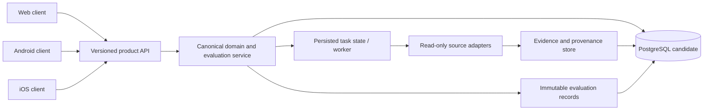

# Evaluación del stack tecnológico (Issue #9)

**Estado:** evaluación documental inicial; decisión final condicionada a PoC ejecutables.  
**Fecha de corte:** 2026-10-24.  
**Alcance:** clientes web, Android/iOS, API central, almacenamiento histórico, procesamiento asíncrono, calidad/seguridad y operación.  
**No constituye** una certificación ISO, una prueba de rendimiento ni una validación de producción.

## 1. Requisitos que condicionan la selección

1. Clientes web, Android e iOS comparten contratos y resultados canónicos; escritorio solo si un requisito posterior lo justifica.
2. El cliente no contiene claves de proveedores ni reglas analíticas canónicas.
3. API versionada y documentada con OpenAPI; validación de contratos automatizada.
4. Persistencia de observaciones y evaluaciones históricas con procedencia, timestamps, versión metodológica y reproducibilidad.
5. Captura externa pública en modo read-only; ninguna orden real de trading.
6. Ejecución bajo demanda, abstención explícita ante datos insuficientes y manejo visible de errores/obsolescencia.
7. El diseño inicial debe poder ejecutarse y probarse localmente en Windows con recursos limitados; no introducir infraestructura distribuida sin evidencia de necesidad.

## 2. Matriz de decisión: criterios y pesos de trabajo

Los pesos son una propuesta de evaluación que suma 100%; deben aprobarse antes de puntuar. Las puntuaciones permanecen **N/E (no evaluadas)** hasta ejecutar PoC comparables. No se asigna un ganador ficticio.

| Dominio | Peso | Evidencia/medición requerida |
|---|---:|---|
| Adecuación funcional y contratos compartidos | 20% | Casos de uso, contrato OpenAPI, validación cliente-servidor |
| Mantenibilidad y reutilización multiplataforma | 15% | Duplicación real, estructura, experiencia de desarrollo |
| Gráficos y manejo de series de mercado | 15% | OHLCV, zoom/pan, volumen y carga de datos reproducible |
| Seguridad y privacidad | 15% | Dependencias, permisos, secretos, logs, límites de confianza |
| Persistencia histórica y consultas | 10% | Escritura/lectura, integridad temporal, consulta por activo/horizonte |
| Pruebas y CI reproducibles | 10% | Tests repetibles desde entorno limpio y artefactos de resultados |
| Recursos locales y experiencia de build | 5% | Versiones, tiempo de build, memoria y tamaño de artefacto |
| Coste operativo/licencias/soporte | 5% | Licencias, mantenimiento, soporte y servicios requeridos |
| Incertidumbre y reversibilidad | 5% | Riesgo de bloqueo, migración y condición de reconsideración |

### Regla de puntuación

- Escala propuesta: 1 (insuficiente), 2 (débil), 3 (aceptable), 4 (fuerte), 5 (muy fuerte).
- Cada puntuación debe enlazar a evidencia reproducible y anotar incertidumbre.
- Resultado ponderado = suma de (peso × puntuación / 5); no calcularlo mientras existan dominios críticos N/E.
- Sensibilidad: recalcular al variar cada peso ±20% y documentar si cambia la alternativa ganadora.
- Umbral de aceptación y reglas para N/E deben aprobarse antes de examinar resultados; no inventar umbrales tras ver la salida.

## 3. Alternativas a probar

| Capa | Candidatos | Riesgo que decide la PoC |
|---|---|---|
| Web | TypeScript + React/Next.js; alternativa React/Vite si SSR no es requisito | Complejidad de despliegue frente a necesidad real de SSR |
| Móvil | Flutter; React Native; Android nativo Kotlin como referencia | Gráficos, accesibilidad, integración, pruebas y coste de mantener iOS |
| API | Python + FastAPI; alternativa Python + Django REST Framework | Contratos, validación, latencia y complejidad de servicio |
| Datos | PostgreSQL sin extensión especializada inicialmente | Consultas históricas, índices, particionado y retención con volumen representativo |
| Tareas asíncronas | Proceso/worker simple y persistente antes de añadir broker | Reintentos, idempotencia, recuperación y observabilidad |
| Streaming/caché/objetos | Diferir hasta demostrar requisito | Carga, latencia, tamaño, coste y necesidad de retención binaria |
| Contratos | OpenAPI + validación y generación de tipos/clientes cuando aporte valor | Detección de incompatibilidades y deriva entre clientes |
| Calidad | pytest u otras herramientas adecuadas a cada lenguaje; análisis estático y escaneo de dependencias | Repetibilidad, cobertura de comportamiento crítico y falsos positivos |

## 4. Plan de PoC reproducibles (obligatorio antes de decisión final)

Todas las alternativas comparadas deben usar el mismo caso de uso, dataset de prueba versionado y criterios fijados previamente.

### PoC-A: contrato API
- Definir un contrato mínimo versionado para buscar un activo y obtener una evaluación fechada.
- Incluir estados de datos insuficientes, timeout, error del proveedor y resultado obsoleto.
- Validar ejemplos válidos e inválidos, compatibilidad y errores de esquema.
- Registrar comandos, versiones, salida y hashes de artefactos.

### PoC-B: persistencia histórica
- Guardar dos evaluaciones de un mismo activo sin sobrescribir la anterior.
- Consultar por activo, horizonte y fecha; verificar orden temporal, procedencia y versión metodológica.
- Registrar plan de consulta y tiempos solo con dataset y entorno descritos; no extrapolar resultados.

### PoC-C: cliente multiplataforma y gráficos
- Implementar la misma pantalla de búsqueda/ficha en las alternativas móviles consideradas.
- Renderizar el mismo fixture OHLCV, con volumen, zoom/desplazamiento y estados vacíos/error.
- Probar escalado de texto, lector de pantalla, movimiento reducido y orientación/tamaño de pantalla.
- En React Native/Flutter, registrar versiones y comandos de build en Windows; Android nativo sirve como referencia, no como decisión automática.

### PoC-D: tarea asíncrona
- Ejecutar una tarea de investigación con clave de idempotencia, reintento acotado y estados persistidos.
- Demostrar que un fallo de red no se convierte en captura válida ni duplica efectos.
- Verificar recuperación tras terminar el proceso y visibilidad del fallo.

### PoC-E: CI y seguridad
- Ejecutar pruebas desde un entorno limpio, análisis estático y revisión de dependencias.
- No imprimir secretos ni datos sensibles en logs.
- Conservar artefactos de resultados y versión exacta de herramientas.
- Un workflow verde solo acredita los checks ejecutados; no acredita rendimiento, conformidad ISO ni preparación para producción.

## 5. Diseño de límites recomendado para validar

- **Clientes:** presentación, accesibilidad, estado local no canónico y visualización; sin claves de proveedores ni lógica analítica duplicada.
- **API de producto:** autenticación/autorización, validación de contratos, versionado, límites de solicitud y respuestas de error consistentes.
- **Servicios de dominio:** identidad de activos/mercados, evaluación, metodología versionada, ranking y evidencia temporal.
- **Adaptadores de fuentes:** conectores aislados con permisos, límites, trazabilidad, procedencia y manejo de fallos específicos.
- **Persistencia:** PostgreSQL candidato inicial para metadatos, evaluaciones y observaciones normalizadas; validar el patrón temporal antes de extensiones especializadas.
- **Worker:** inicialmente proceso sencillo con estado persistido e idempotencia; introducir broker/caché/streaming solo con evidencia de carga o latencia.
- **CI y observabilidad:** pruebas, auditoría de cambios, logs estructurados sin secretos, métricas de fallos y artefactos reproducibles.

## 6. Registro de evidencia actual y brechas

- README de main describe clientes web, Android e iOS conectados a una plataforma central y prohíbe inferir preparación para producción sin evidencia integral.
- El comentario previo en Issue #9 registró que no se encontraron en la raíz los marcadores habituales de una aplicación Android/Flutter/React Native; tampoco acreditó una compilación móvil.
- El comentario de auditoría asociado a Issue #270 calificó provisionalmente la selección tecnológica en 3/10 por ausencia de PoC comparativas y benchmarks verificables.
- La rama de trabajo debe completar PoC, actualizar esta matriz con evidencias reales y registrar el ADR final. Hasta entonces, el stack definitivo queda **pendiente**, no aprobado.

## 7. Condiciones de cierre del Issue #9

- [ ] Matriz con puntuaciones respaldadas por evidencia y análisis de sensibilidad.
- [ ] PoC ejecutables para API, cliente/gráficos, persistencia y tareas asíncronas.
- [ ] Comandos, versiones, entorno, resultados y fallos reproducibles.
- [ ] ADR final con alternativa seleccionada, consecuencias, riesgos y condiciones de revisión.
- [ ] CI relevante verde y PR revisado; ningún cambio directo a main.
- [ ] Los resultados no afirman conformidad ISO/certificación ni rendimiento no medido.

**Conclusión actual:** la arquitectura lógica y el protocolo de evaluación quedan definidos, pero cerrar el Issue como completado antes de las PoC sería una afirmación no respaldada.


## 8. CI observada para el PR #301 (2026-10-24)

Se consultaron las ejecuciones asociadas al commit `569e9712d6e5fa5c94dc6a0b4545f3bd3f5935fd`. Dos workflows finalizaron con los jobs observados en PASS:

| Workflow | Run ID | Job | Resultado observado | Alcance real |
|---|---:|---|---|---|
| Reproducible market capture evaluation | 40056223784 | Test offline capture evaluation | PASS | Pruebas unitarias existentes, fixture sintético determinista y comparación de salidas; no compara stacks de aplicación |
| Requirements traceability validation | 40056223782 | Validate requirements catalogue and traceability | PASS | Validador del catálogo de requisitos y trazabilidad; no demuestra que las PoC de este Issue estén ejecutadas |

En ambas ejecuciones, el job de detección de alcance también terminó correctamente. Esto significa que los workflows existentes se ejecutaron, pero **no** constituye PASS de PoC de FastAPI/alternativas, clientes móviles, gráficos, PostgreSQL o procesamiento asíncrono. Tampoco demuestra que todos los checks del PR estén terminados ni que el stack esté aprobado.

- Run 40056223784: https://github.com/Osleyder1985/crypto-intelligence-ecosystem/actions/runs/40056223784
- Run 40056223782: https://github.com/Osleyder1985/crypto-intelligence-ecosystem/actions/runs/40056223782
- PR: https://github.com/Osleyder1985/crypto-intelligence-ecosystem/pull/301


## 9. Artefacto adicional: contrato API preliminar

Se añadió `docs/architecture/stack-poc-openapi.yaml` con un contrato OpenAPI 3.1.0 provisional para:
- búsqueda del catálogo canónico de activos;
- consulta de evaluaciones históricas inmutables por activo/horizonte;
- solicitud de evaluación bajo demanda con clave de idempotencia;
- consulta del estado de procesamiento y estados explícitos `failed`/`indeterminate`.

El servidor `example.invalid` es deliberadamente un marcador de posición, no un endpoint operativo. El contrato todavía requiere validación con un parser OpenAPI, pruebas de contrato y revisión de autenticación/autorización antes de considerarse válido o implementado. La existencia del YAML no acredita una API funcionando.

## 10. Diagrama de límites propuesto



Este diagrama expresa límites propuestos, no infraestructura desplegada. La elección concreta de worker, persistencia de evidencia y almacenamiento de objetos queda pendiente de PoC y requisitos de retención.

## 11. Estado actualizado de aceptación

- [x] Criterios y pesos de evaluación documentados como propuesta (sin puntuaciones inventadas).
- [x] ADR provisional con alternativas, riesgos y condiciones de revisión.
- [x] Contrato OpenAPI inicial y diagrama lógico propuestos.
- [x] Dos workflows existentes observados en PASS, con sus límites documentados.
- [ ] Validación automatizada del contrato OpenAPI y pruebas de contrato.
- [ ] PoC comparativas de cliente móvil/gráficos, API, persistencia histórica y tarea asíncrona.
- [ ] Matriz puntuada con resultados medidos y análisis de sensibilidad.
- [ ] ADR definitivo ratificado y revisión del PR.


## 12. CI específico del contrato OpenAPI

Se añadió `.github/workflows/issue-9-openapi-contract.yml`. En el commit `b64ce55e49c4271ad7702697e43a08c0b599c5c8` se sustituyó la validación artesanal por el validador de especificaciones OpenAPI `openapi-spec-validator==0.7.2`, con Python 3.12 y las acciones de checkout/setup-python fijadas a SHA completos.

Comando configurado en CI:

```bash
python -m pip install --disable-pip-version-check openapi-spec-validator==0.7.2
openapi-spec-validator docs/architecture/stack-poc-openapi.yaml
```

**Estado de ejecución:** no confirmado. La consulta de ejecuciones asociadas a ese commit y los estados combinados no devolvió resultados; por tanto, no se registra PASS hasta que GitHub Actions publique un resultado verificable. Incluso con el validador OpenAPI en PASS, seguirán pendientes las pruebas de contrato cliente-servidor y las PoC comparativas de API, persistencia histórica, cliente/gráficos y tareas asíncronas.

## 13. PoC ejecutable de API, historial e idempotencia

Se añadieron `scripts/stack_poc/research_api.py`, `tests/stack_poc/test_research_api.py` y el workflow `.github/workflows/issue-9-stack-poc.yml`. La PoC usa FastAPI con SQLite para poder ejecutar pruebas sin un servicio de base de datos local; **SQLite es únicamente una ayuda de prueba y no valida PostgreSQL ni sustituye la PoC de persistencia requerida**.

Comportamientos que cubren las pruebas automatizadas:
- búsqueda del catálogo de activos y forma de respuesta vacía;
- autenticación Bearer configurable, sin credencial predeterminada; el servicio falla cerrado si no se configura el secreto;
- solicitud bajo demanda con clave de idempotencia, repetición del mismo payload y conflicto HTTP 409 cuando la clave se reutiliza con otro payload;
- errores 404 para activo/solicitud inexistente;
- persistencia de dos evaluaciones históricas con metodología distinta, orden temporal y filtro por horizonte.

El workflow instala versiones fijadas de FastAPI y HTTPX y ejecuta `unittest` en Python 3.12. **Resultado CI observado:** el run [40056765545](https://github.com/Osleyder1985/crypto-intelligence-ecosystem/actions/runs/40056765545) ejecutó el job `api-history-idempotency` y el paso `Run API, history and idempotency PoC tests` terminó en `success`. El job figura con todos los pasos completados; la consulta general del run todavía mostraba estado `in_progress` durante la verificación, por lo que se confirma el paso de pruebas PASS, no el cierre final del run. Esta evidencia corresponde al commit de pruebas `dcbc8c63f7365195258f39c923c6e7270ece4871`; el commit documental posterior no modifica el código probado. La implementación no ejecuta análisis real ni worker asíncrono: las solicitudes permanecen `queued` en esta PoC. Tampoco implementa autorización por roles, migraciones, PostgreSQL, límites operativos ni pruebas de concurrencia; estos son riesgos/alcances pendientes.

## 14. PoC de persistencia PostgreSQL

Se añadió `scripts/stack_poc/postgres_schema.sql`, una prueba de integración `tests/stack_poc/test_postgres_history.py` y el workflow `.github/workflows/issue-9-postgres-poc.yml`. El workflow levanta PostgreSQL 16 como servicio efímero, instala `psycopg[binary]==3.2.6` y ejecuta pruebas con Python 3.12.

La PoC verifica:
- escritura de evaluaciones distintas para el mismo activo, con horizonte y versión metodológica;
- orden de consulta por timestamp descendente;
- rechazo explícito de `UPDATE` y `DELETE` sobre el historial mediante trigger de PostgreSQL.

**Estado:** implementación añadida; ejecución CI pendiente de confirmación. No registrar PASS hasta consultar el job. Es una prueba de esquema/retención de historial, no un benchmark representativo, una migración de producción ni una validación de recuperación/backup. El worker persistente y la idempotencia transaccional todavía requieren PoC separada.
